# CraftGraph

> $\color{red}{\textbf{EXPERIMENTAL}}$ &nbsp; A prototype. It has been tried in the game, but not for long.
> Check what it proposes before you spend gold.

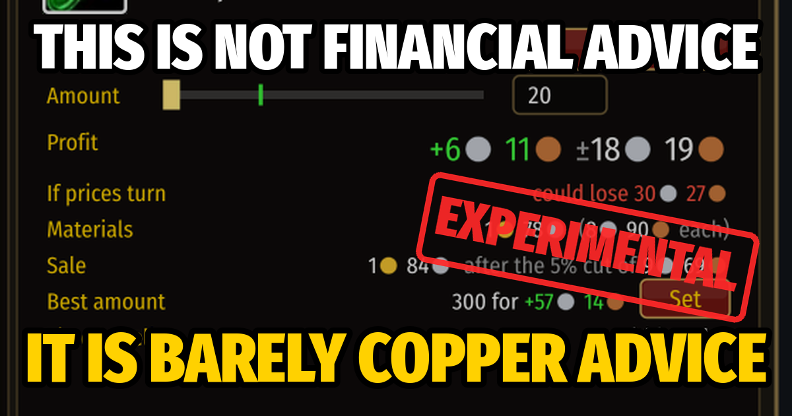

**Make gold at the auction house in World of Warcraft Forever without doing the sums yourself.**
Open it in game with `/cg`.

[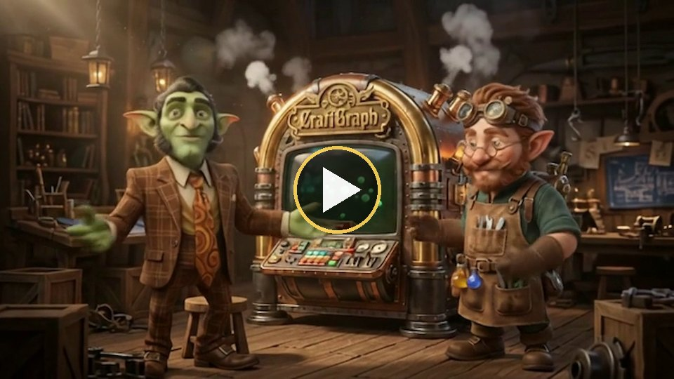](docs/media/goblin-advert.mp4)

*Two goblins show off the machine: a 21-second advert, with sound. Click the picture to play it.*

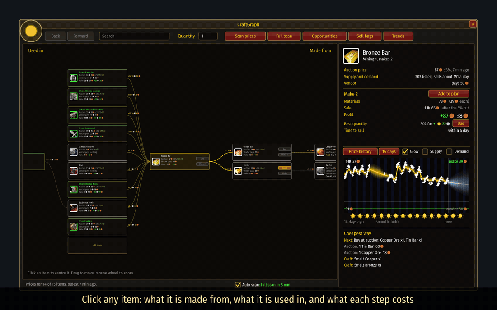

*A one-minute tour ([video](docs/media/tour.mp4)), and, for fun, [the trailer](docs/media/trailer.mp4)
(with sound). The pictures here were drawn from the addon's
own interface code, outside the game, on a simulated market unless they say "real".*

## What you can do with it

**Read the market news.** What moved over the day and the week: the biggest single moves, each
kind of goods, and every profession by rank (Apprentice to Master), materials and goods apart.
Up or down is said only when it is three chances in four; otherwise "steady" or "unclear".

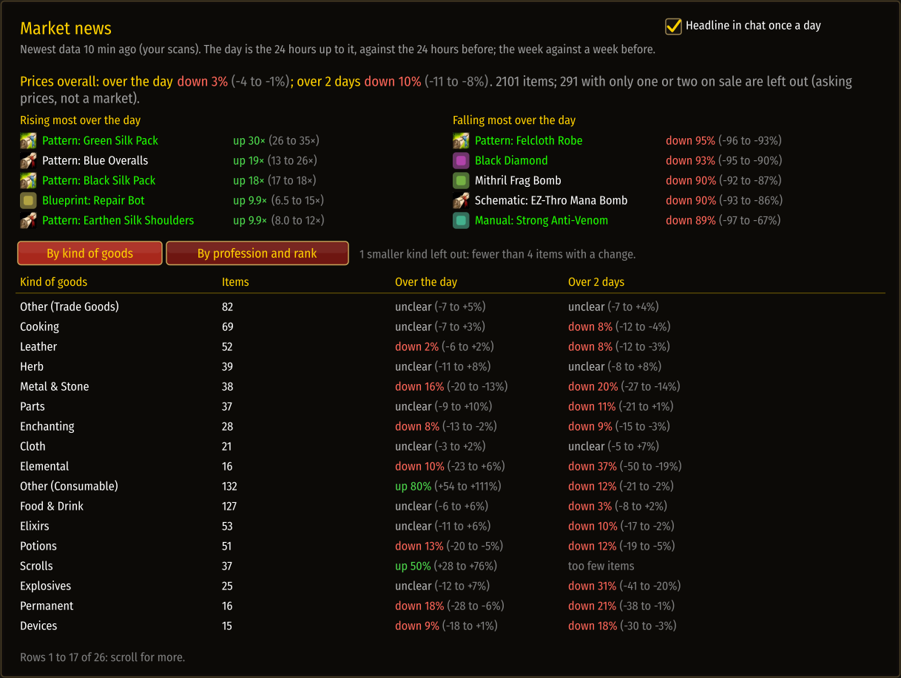

*Real: the news from its author's own scans on the evening of 12 November. Overnight, patterns
and blueprints had jumped ten to thirty times over while metal and stone fell. Drawn from the
addon's own interface code, outside the game.*

It comes with two days of prices from its author's own scans of CAMWOW EU4 Realm 2 PvP
(Alliance), so on that auction house the news and the estimates have something to go on from your
first login. Your own scans always come first; [more about the base data](docs/understand/data-sources.md#the-base-data).

**See what anything is made of.** Click an item and you get a map: what it is made from on the
right, what it is used in on the left, with the price of every step and buttons to buy, make and
sell. Gold lines earn, red ones lose, thicker ones earn more, and small lights drift the way
the money flows. The card with the golden rim is the best thing to make right now.

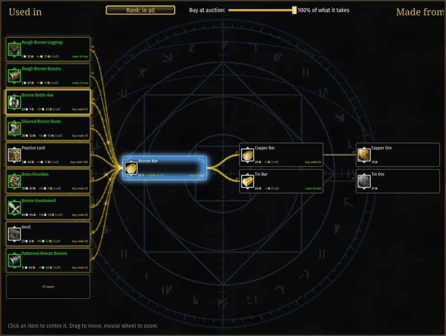

**Get a list of ways to make money right now.** Craft and sell, buy cheap and relist, buy under
vendor price, sell what is in your bags. Each line says what it costs, what it should earn and how
sure that is.

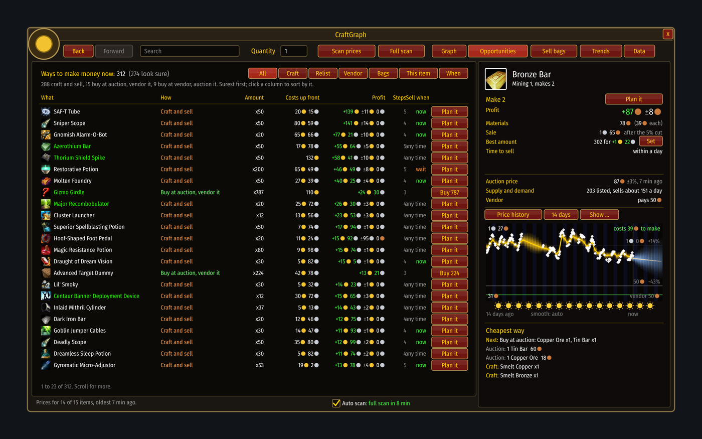

**Ask "what would this cost on a Monday afternoon?"** Drag across the week and read the price.

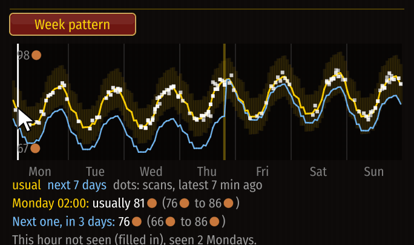

**See why a price moved.** Tick Supply and Demand on the price chart. Here goods flood in (blue)
and the price sinks; then a rush of buyers (green) empties the market and it jumps. Pick how much
to smooth: an hour shows every wiggle, a day shows the story.

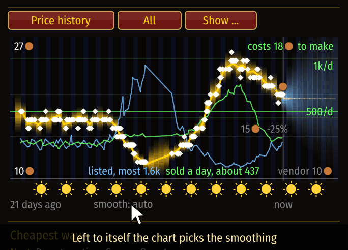

**Make a plan and watch it.** Press "Plan it" and a small window tells you the next step wherever
you are. After every scan it shows what the plan should earn now, and whether that went up or down.

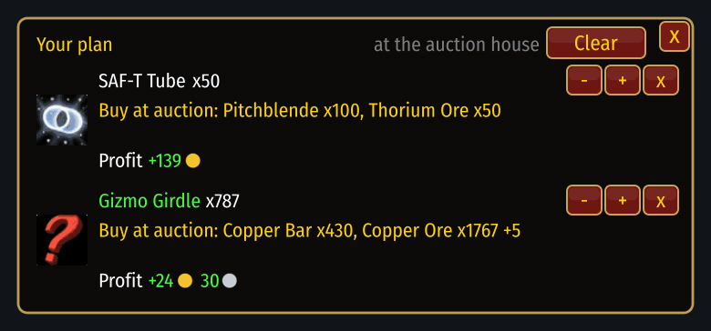

**Follow it step by step.** Pick how many with a slider. The side panel lists every step in
order: what to buy at auction, the trip to the mailbox, which vendor and where, what to craft,
what posting brings after the auction house's cut. Under the profit, one line says what you
could lose if prices turn.

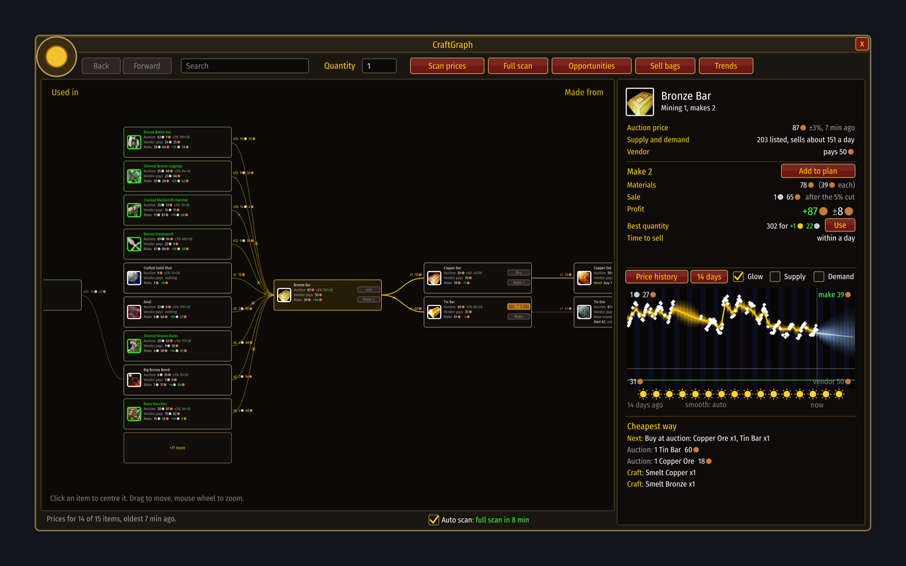

**Ride a wave.** When a crowd of new players arrives, the things they all want double in price
while their own gathering makes the materials cheap. For a few days the same work pays four
times as much. This is an imaginary rush, played through in the window:

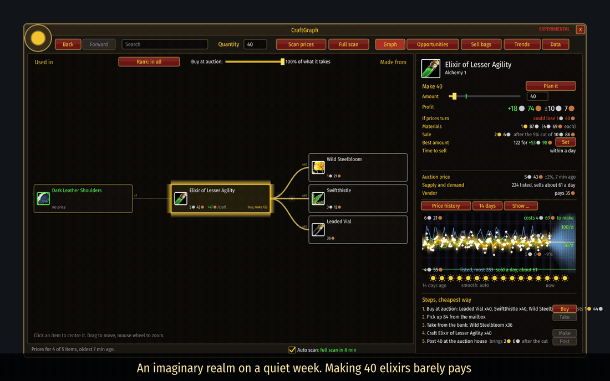

[How to read it, and when to get out](docs/examples/riding-a-wave.md).

**See it on a real market.** Fifteen hours of real scans of one elixir on a two-day-old economy:
a thin margin, a line in red saying what could be lost, and no forecast, because there is not
enough to go on yet. [The walk-through](docs/examples/real-item.md).

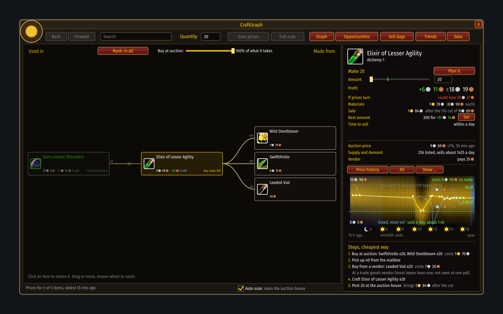

**Share prices with friends.** Export your latest scan as text, send it, and they import it with
one paste. It tells them plainly whether it worked.

**Know when to sell.** For anything you hold, it names the best hour this week, if there is one.

**Trust it to say "I don't know".** With too few scans, or a price that jumps about, it shows only
what it saw and tells you why. One switch shows the guess anyway.

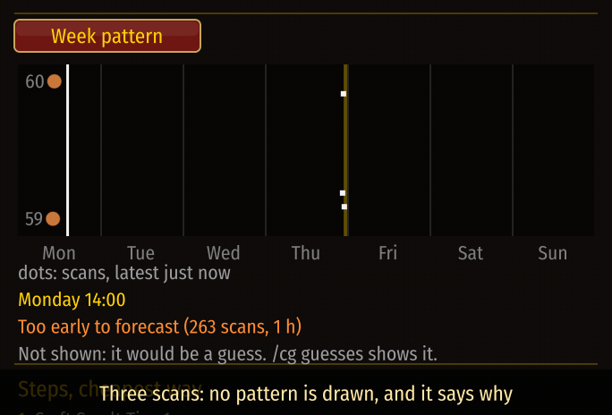

## Install

1. Download the `CraftGraph` zip from the [latest release](https://github.com/t-more/craftgraph/releases/latest) and unzip it.
2. Windows: double-click **Install CraftGraph**. Anything else: copy the `CraftGraph` folder into
   `World of Warcraft/_forever_/Interface/AddOns/`.
3. Start the game, open the auction house, type `/cg` and press **Full scan**.

It needs nothing but the game. **Experimental:** it has been tried in the game, but not for long,
so expect rough edges and please say what breaks. [More on installing](docs/start/install.md).

## Your responsibility
This is a prototype made by a few friends. It comes as it is, and how you use it is up to you:
your gold, your account, and, if you turn on the optional Blizzard prices, your own API key and
Blizzard's terms. Read [LEGAL.md](LEGAL.md) before you rely on it. Not affiliated with or
endorsed by Blizzard.

## Want to know more?

Start at the [guide](docs/README.md). It goes from "what do I click" to "how does the maths work",
one step at a time, and you can stop wherever you like.

| I want to... | Read |
|---|---|
| get going | [Your first session](docs/start/first-session.md) |
| make gold | [Opportunities](docs/play/opportunities.md), [Plans](docs/play/plans.md), [When to sell](docs/play/timing.md) |
| see it in action | [A real item, today](docs/examples/real-item.md), [Riding a wave](docs/examples/riding-a-wave.md) |
| understand the numbers | [Prices and history](docs/understand/prices-and-history.md), [Forecasts](docs/understand/forecasts.md) |
| see how it is built | [Under the hood](docs/internals/README.md) |
