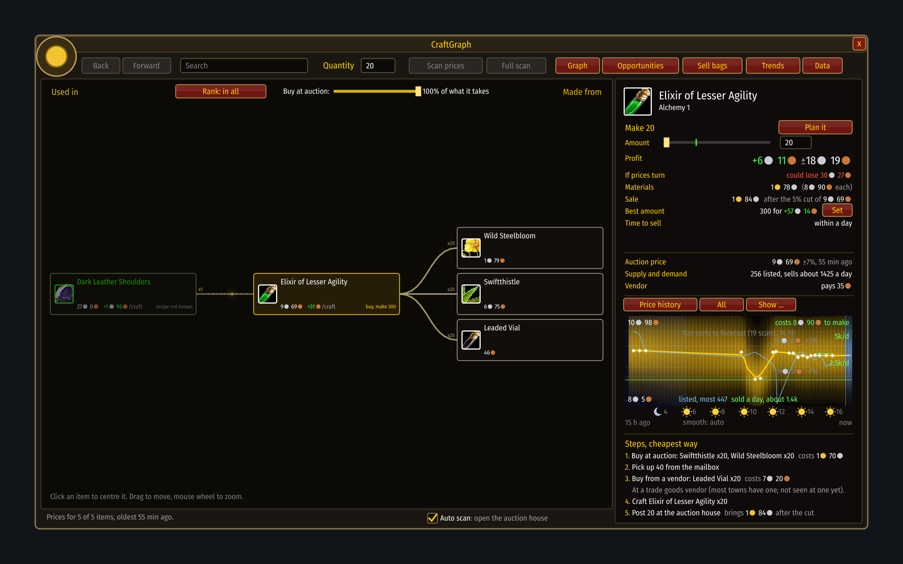
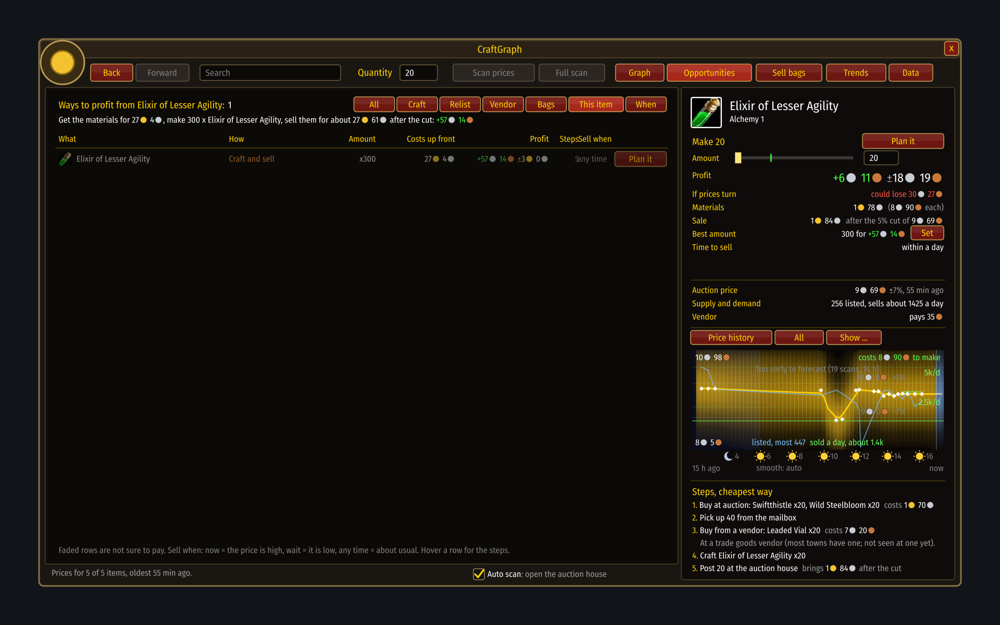

# A real item, today

[Guide](../README.md) › [Examples](README.md)

This page is drawn from real scans, not the simulated market: one player's auction house on
10 November 2026, a young economy where nothing has settled yet. The item is **Elixir of
Lesser Agility**. Only prices are shown; no seller or character names.

## What the window says

**Here and now.** The cheapest elixir was listed at 9s 69c, 55 minutes ago. That figure leads;
everything else is a second opinion.

**What it is made of.** One Wild Steelbloom (1s 79c), one Swiftthistle (6s 75c) and a Leaded
Vial. The vial is 46c at auction but 36c from a vendor, so the steps send you to a vendor for it.
Most of the cost is the Swiftthistle: if that herb moves, the whole craft moves.

**What 20 would earn.** Materials 1g 78s, sale 1g 84s after the auction house has kept its 5%
(9s 69c). That leaves **+6s 11c**, give or take 18s.

**What you could lose.** *If prices turn* reads **could lose 30s 27c**. The margin is thinner
than the uncertainty, so this is a coin toss with a small edge, not a sure thing. Twenty is a
fair bet; the "best amount" of 300 would earn about 57s on paper and tie up about 27g to do it.

**The chart.** Fifteen hours of history. Around ten in the morning the price dipped to 8s 92c
and came back within the hour: someone undercut, and the cheap ones were bought. Blue is how
many were listed, green how many sold a day.

**No forecast.** *Too early to forecast (19 scans, 14 h)*. A pattern by hour or weekday needs at
least eight scans over two days, and this market is two days old. The tool shows what it saw and
stops there; `/cg guesses` shows the guess anyway if you are curious.

## All the ways to profit from it

One line today: craft and sell. No flip (nobody is listing far under the rest) and no vendor
trick. The row is faded because it is not sure to pay.

## What to do with that

- Make a small batch if you have the herbs anyway. Buying 27g of herbs for a 57s edge is not
  worth the risk on day two.
- Watch the Swiftthistle. It is three quarters of the cost.
- Scan again tonight and tomorrow. After two days the hour-of-day pattern appears, and
  [When to sell](../play/timing.md) starts to mean something.

Next: [Riding a wave](riding-a-wave.md)
