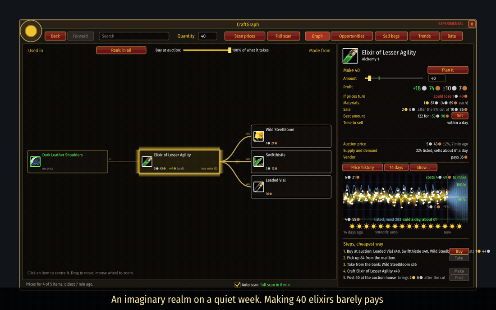
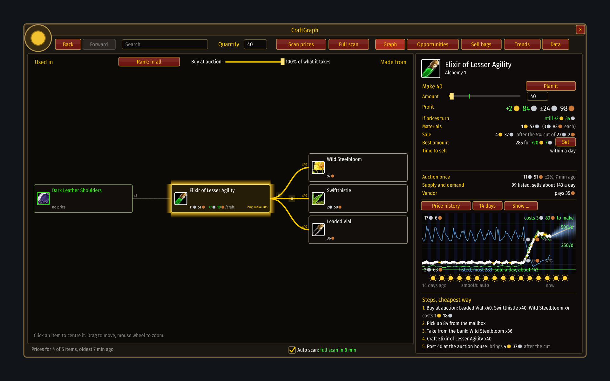
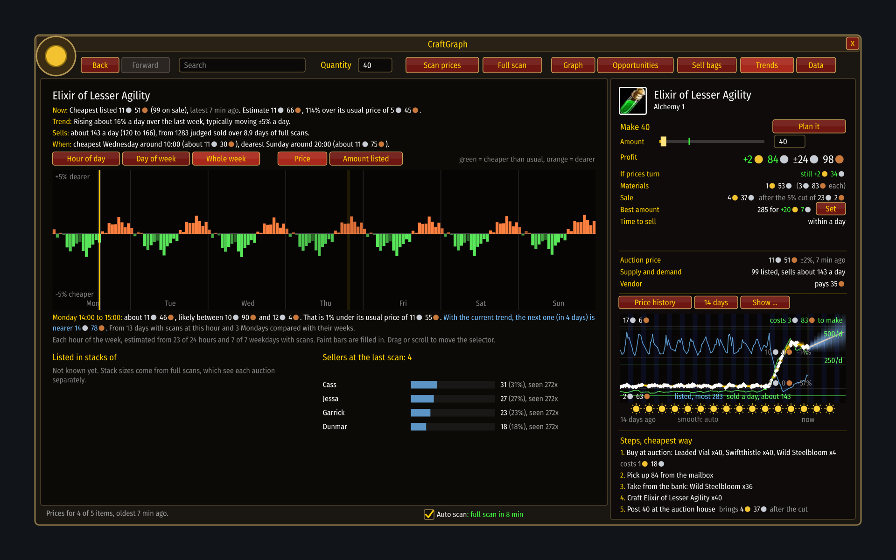
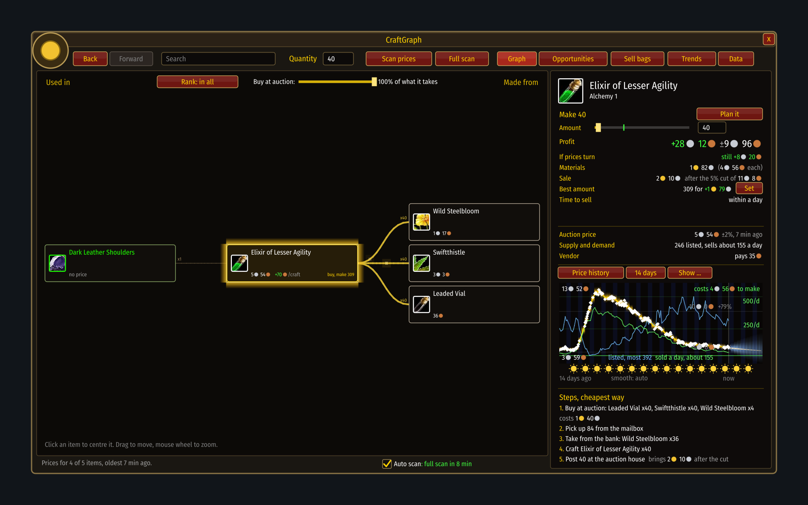

# Riding a wave

[Guide](../README.md) › [Examples](README.md)

**This is an imaginary scenario on a simulated market.** Nothing here happened. It shows what a
rush looks like in the window, so that you recognise one when it comes: a new realm opening, a
patch, a streamer bringing a crowd.

## The story

A quiet realm. Elixir of Lesser Agility sells for about 5s 40c and costs nearly that to make.
Forty of them earn 19s. Not worth an evening.

Then a crowd of new players arrives, all levelling at once, all wanting the same elixir.

| Day | What happens | 40 elixirs earn |
|---|---|---|
| before | quiet | 19s |
| 1 | the shelf is bought nearly empty; the price starts to climb | 1g 19s |
| 2 | the price has doubled; the crowd's own gathering starts to flood the herbs | 2g 52s |
| 3 | herbs are cheaper than before the rush, the elixir is still dear | **2g 84s** |
| 4 to 5 | still good, sliding | 2g 65s, 2g 34s |
| 6 to 8 | other alchemists have caught up: more listed, price falling | 2g 3s down to 1g 27s |
| 9 to 13 | back to normal | 82s down to 28s |

One batch each evening on days 1 to 5 comes to about **11g 54s**. The same five evenings on
days 9 to 13: **2g 74s**. Same work, a quarter of the gold.

## What the window shows on day 3

- **The golden rim** is on the elixir: of everything on screen it is the best thing to make.
- **Profit +2g 84s**, and *If prices turn* still says **+2g 34s**. Even the bad case pays. On a
  quiet day that line is red.
- **The chart** shows the price leaving its old level. Green (sold a day) jumped first; that is
  the crowd. Blue (listed) fell: the shelf is empty.
- **The materials** on the right are cheaper than a week ago. A rush of players is also a rush
  of gatherers, a day or two behind.
- **The steps** list what to buy and where. With a plan pinned, the small window follows it and
  says after every scan whether it went up or down.

The Trends page says the same in four lines: the price is more than double its usual level and
still rising.

## And two weeks on

The whole wave is one hill on the chart. Sales fell back before the price did: by the time the
price looks "high and stable", the buyers are already leaving.

## What to take from it

1. **Demand moves first.** When *sells a day* jumps and *listed* drops, the price follows within
   hours. Tick **Demand** and **Supply** on the chart ([When to sell](../play/timing.md)).
2. **Materials lag.** The best margin is not on day 1 but once the crowd's own gathering makes
   the materials cheap, while the product is still dear.
3. **It ends when others catch up.** Rising *listed* with a falling price means the window is
   closing. Sell what you have; do not make more.
4. **Small batches, often.** Scan, make what sells today, sell it today. The steps and the
   bad-case line are worked out again for whatever amount you set.
5. **Do not lean on the forecast.** It follows the trend, and a rush breaks the trend twice: the
   forecast lags on the way up and overshoots at the top. The latest scan and its age are what
   count, so scan often ([Auto scan](../play/auto-scan.md)).

In a restarted economy the first weeks are several of these waves, one per level range, as the
crowd moves up. The same picture repeats with different potions, bars and cloth.

Back to [Examples](README.md)
