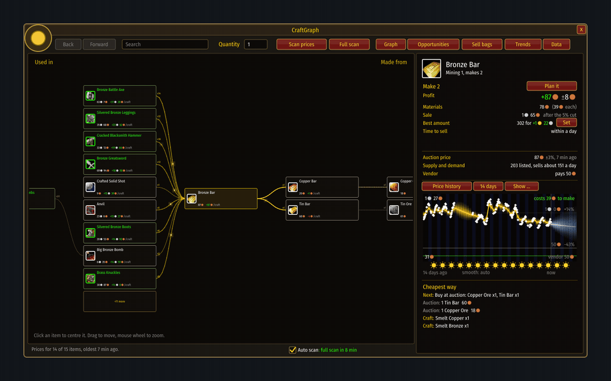
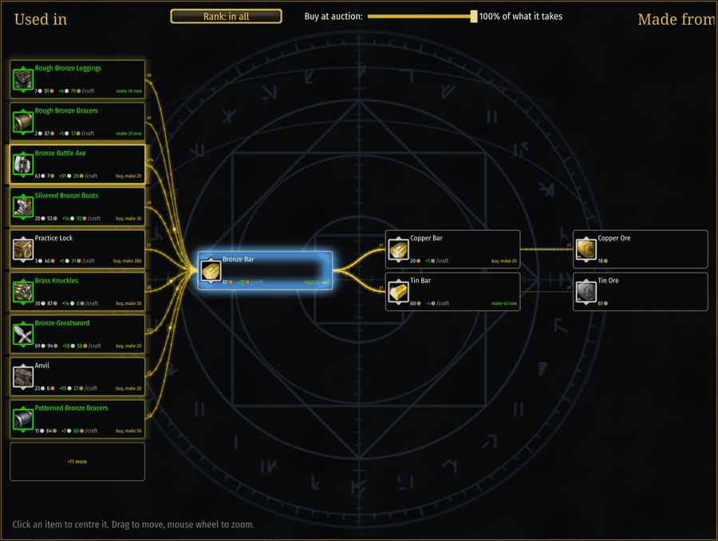
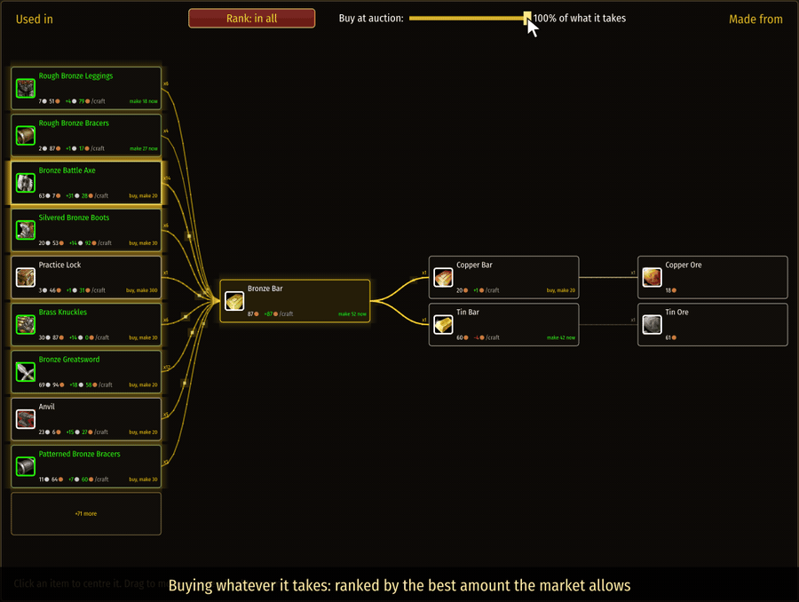
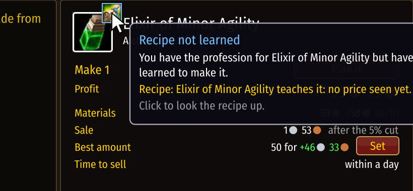

# The graph

[Guide](../README.md) › Playing with it

Click an item (or search for it) and it sits in the middle. To the **right** is what it is made
from, down to raw materials. To the **left** is what it is used in.

Each card shows:
- the cheapest auction price and how sure that is, then how many sell a day (`120/d`; `120+/d`
  means "at least");
- what a vendor pays, or charges if vendors stock it;
- what it costs to make, and the profit of making it.

Each card has up to three buttons: **Buy**, **Make**, **Sell**. The one to press now is lit. One
that makes no sense is grey, and hovering it says why.

The lines between cards carry the amount and its value: for your plan's quantity on the
"made from" side. Their colour says whether the step earns money: **gold** when making the next
thing pays, **grey** around nothing, **red** towards a loss. Where a step clearly earns, a faint
light drifts along its line from the material towards the thing made of it (`/cg flow` switches
the lights off).

Lines are **thicker** towards the things that earn the most among those on screen, and each
line carries what one craft of the thing it leads to earns, such as `+35c/craft`.

## What to make: the golden rim
Every craftable card is scored and the scores are compared across what is on screen. The more
golden a card's glow, the better it is to make; the best one breathes, and a glint crosses it now
and then.

- **Groups.** Things made from the item in the middle are listed in three groups: what you can
  make now from your bags and bank (`make 18 now`), what needs materials bought first
  (`buy, make 20`), and recipes you do not know (greyed). Within each group the best score is
  first.
- **Rank: in all / per craft.** The button at the top switches between what the whole amount you
  could make now earns, and what one craft earns.
- **Buy at auction.** The slider says how far you are willing to go beyond what you own: at
  nothing, cards are ranked by what your own stock can make; at 100%, by the best amount the
  market allows. Drag, click or scroll it.
- **Cautious on purpose.** A score is the estimate less its margin, so a craft that only looks
  good because its prices are unsure does not win. Hover a card for the numbers behind its rank.

## Recipes you have not learned
If you have the profession for something but have not learned its recipe, a small mark sits on
the top right corner of its icon: the item that teaches the recipe (a pattern, plans, a formula),
or a book when a trainer teaches it. Hover it for where to get it and what it costs at auction;
click it to look the recipe up. The same mark appears in the side panel and in the lists.

**Moving around:** click a card to centre it, drag to pan, mouse wheel to zoom. The mouse's back
and forward buttons go back and forward.

The panel on the right belongs to the item in the middle: its prices, what a batch earns, the
price chart and the cheapest way to make it.

Next: [Opportunities](opportunities.md)
