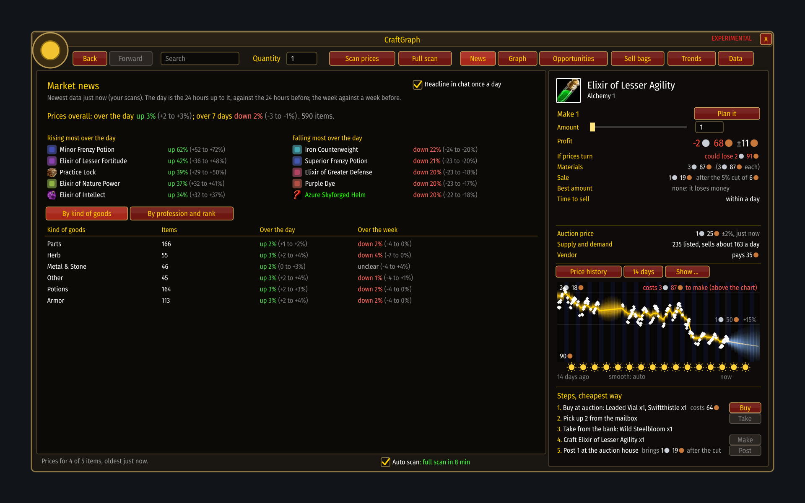
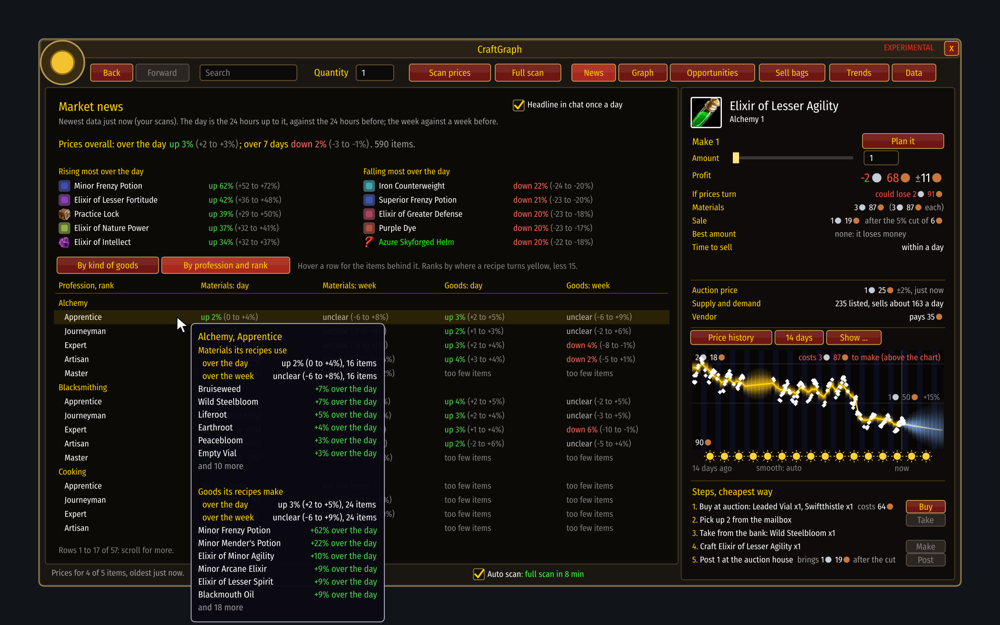

# News

[Guide](../README.md) › Playing with it

What moved in the market over the day and over the week. Press **News** (the first of the page
buttons), or type `/cg news`. Once a day, a little after you log in, the main moves are also said
in one line of chat; untick **Headline in chat once a day** to stop that.

- **On top**: how old the newest data is and where it came from. The news is about the 24 hours
  up to the newest data, against the 24 hours before, so it says so in orange when that is not
  today: scan to bring it up to date.
- **Prices overall**: the middle of every item's change, over the day and over the week, each
  with a range.
- **Rising and falling most**: single items that moved most over the day. Only items seen at
  least twice on both days, with at least five on sale and worth at least a silver. Click one to
  open it in the graph.
- **By kind of goods**: the game's own kinds (Herb, Cloth, Metal & Stone, Potions...).
- **By profession and rank**: for every profession and every rank (Apprentice, Journeyman, Expert,
  Artisan, Master), the materials its recipes use and the goods they make, over the day and the
  week. Hover a row to see the items that moved most in it.

## How to read it
- **up 4% (+2 to +6%)**: the middle of the items' changes and a range that holds it four times in
  five. A price that more than doubled reads as a multiple: **up 3.1× (2.4 to 3.9×)**.
- **up** and **down** (in colour) are said only when the direction is three chances in four.
  Otherwise it is **steady** (the range stays within 2% either way) or **unclear** (it could be
  either).
- **too few items**: fewer than four items with a change. Better to say nothing than guess.
- **Over 3 days** instead of **Over the week**: there is less than a week of history yet, so the
  week compares with the earliest day there is, and says how far back that is.
- Items with only one or two on sale are left out: those are asking prices, not a market. The
  line on top says how many.
- **Ranks** go by the skill at which a recipe turns yellow, less 15, which is roughly where it is
  learned. The game data does not say the learning level itself.

The news uses whatever sources are switched on: your scans, the base data from before them,
Blizzard's hourly data and prices shared with you. With round-the-clock data (Blizzard's) the day
before is always there; with your own scans now and then, an item needs a scan on both days.

Next: [The graph](graph.md)
