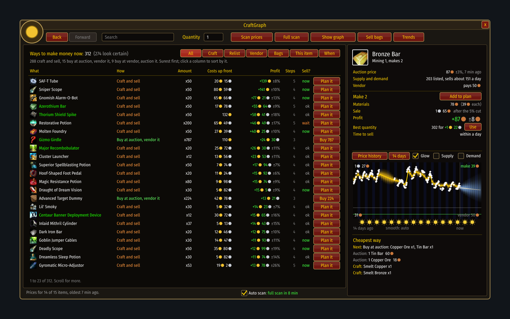
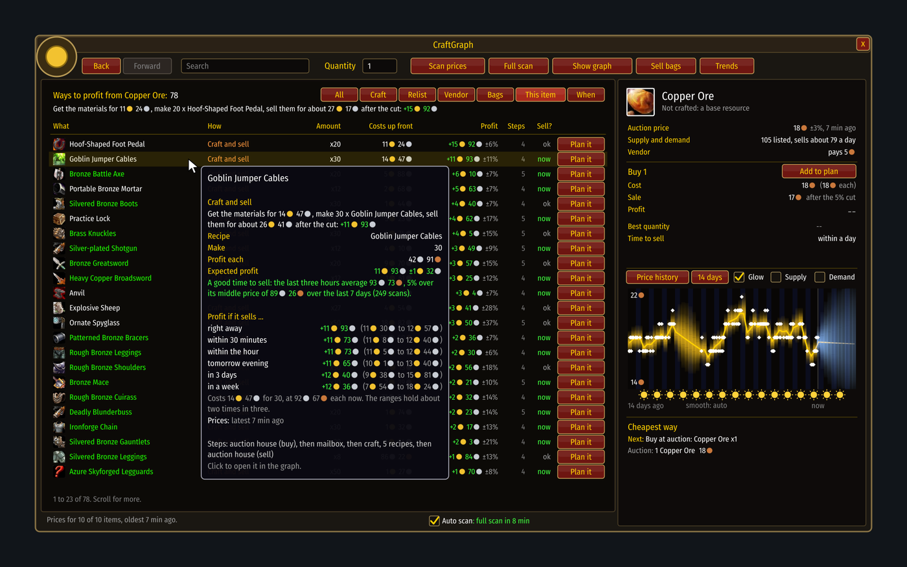

# Opportunities

[Guide](../README.md) › Playing with it

Every way to make money right now, in one list. Nothing is left out for being small or
fiddly: you judge the effort.

| Kind | What you do |
|---|---|
| Craft and sell | make something you know the recipe for |
| Buy low, relist | buy the cheap end of the listings and post it again higher |
| Buy at auction, vendor it | buy what is listed under vendor price |
| Buy at vendor, auction it | buy what a vendor stocks and post it |
| Sell from your bags | list what you already hold |

Each row shows the amount worth doing, what it costs up front, the profit with its margin, and
the number of steps. Faded rows are not certain to pay.

## Sell?
The small **Sell?** mark says whether now is a good time to sell the thing a row ends in: `now`
when the last three hours are clearly above its middle price of the last week, `wait` when
clearly below, `ok` in between, a dash when there is too little to compare. Hover the row for the
numbers. It is a plain comparison, not a forecast, so it works from the first day.

## This item
The **This item** filter shows every option that involves the item you are looking at: trading
it, and crafting something from it. Hover a row for an example in plain words and the profit by
when it sells.

## When
The **When** filter lists what you hold, or can make, with the best hour this week to sell it.
See [When to sell](timing.md).

## The button
- **Plan it** puts the row in your [plan](plans.md).
- At the auction house, trades show **Buy** instead; Shift-click plans it.
- Buying refuses if the listings now cost more than the row counted on.

Next: [Plans](plans.md)
