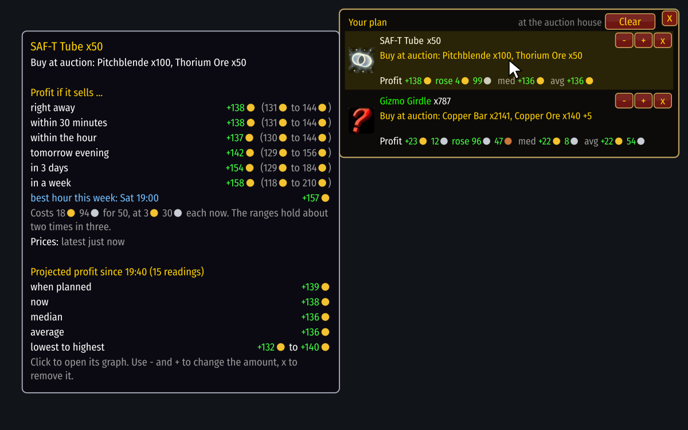

# Plans

[Guide](../README.md) › Playing with it

A plan is something you decided to do. Press **Plan it** and a small window
appears that stays with you: at the auction house, the mailbox, the bank, a vendor.

For each planned item it shows:
- **the next step**, in order: buy at auction, collect mail, buy at a vendor, craft, post;
- **the profit it should earn now**, and how the last scan moved it (`up` or `down`);
- **`med` and `avg`**: the median and average of that profit since you planned it.

So if a scan corrects a price and your plan is suddenly worth less, you see it at once.

## Profit by when it sells
Hover a plan for the breakdown: right away, within 30 minutes, within the hour, this evening, in
3 days, in a week, and the best hour this week. Each has a likely range. Later times are left
out when the price cannot be forecast.

## Changing a plan
`-` and `+` change the amount (Shift for steps of 10) and everything is worked out again. `x`
removes one item. **Clear**, pressed twice, empties the plan. On the graph, each material shows
what you own in bags and bank and lets you set how much of it the plan may use.

Next: [When to sell](timing.md)
