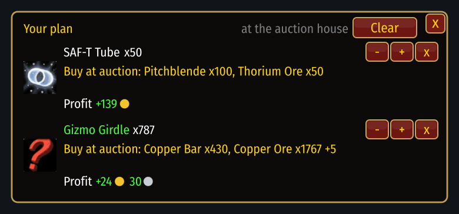
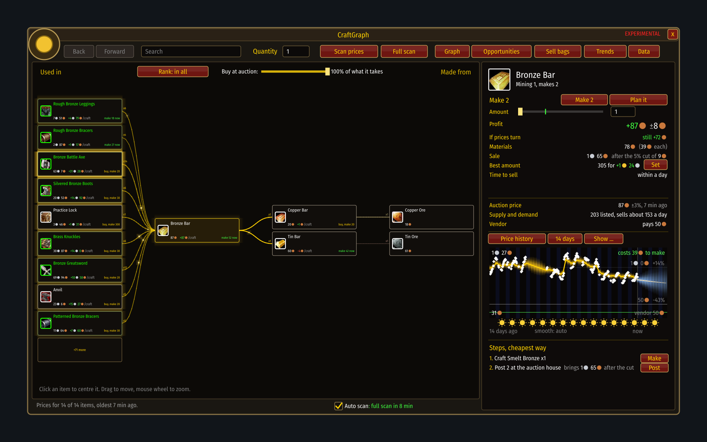
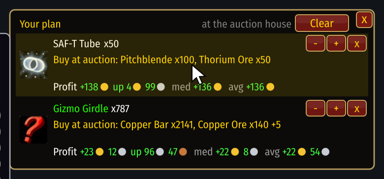

# Plans

[Guide](../README.md) › Playing with it

A plan is something you decided to do. Press **Plan it** and a small window
appears that stays with you: at the auction house, the mailbox, the bank, a vendor.

For each planned item it shows:
- **the next step**, in order: buy at auction, collect mail, buy at a vendor, craft, post;
- **the profit it should earn now**, and how the last scan moved it (`up` or `down`);
- **`med` and `avg`**: the median and average of that profit since you planned it.

So if a scan corrects a price and your plan is suddenly worth less, you see it at once.

## Profit by when it sells
Hover a plan for the breakdown: right away, within 30 minutes, within the hour, this evening, in
3 days, in a week, and the best hour this week. Each has a likely range. Later times are left
out when the price cannot be forecast.

## How many
In the side panel, under the item's name, the **Amount** slider and the box beside it set how
many to make. Drag, scroll (Shift for tens) or type a number. Profit, cost and the steps follow
at once, and **Plan it** plans that many. The green mark on the slider is the best amount. For an
item already in your plan, changing the amount changes the plan.

## Step by step
Under the chart the side panel lists every step in the order to do them, with what each costs
or brings:

1. **Buy at auction**: what, how many, and the cost.
2. **Pick up from the mailbox**: what you buy at auction arrives by mail.
3. **Buy from a vendor**, with where: the vendor and place where you last saw it sold, or a
   general pointer if you have not been to one yet.
4. **Take from the bank**, when your own stock is there.
5. **Craft**, materials first.
6. **Post at the auction house**, with what it brings after the auction house's cut.

What you already hold is left out. For a planned item the step that is next is marked **Next**.
The plan window lists the same steps under each planned item.

### A button on every step
Each step has a small button that does it for you. It is grey until you are where the step can
be done, and hovering it says where that is:

| Button | Lights up | Does |
|---|---|---|
| **Buy** (auction) | at an auction house | buys one of the step's items for each press, at no more than the plan expected |
| **Take** | at a mailbox | takes the auctions you won out of the mail, one letter at a time; other mail is left alone |
| **Buy** (vendor) | at a vendor that sells it | buys what the step needs |
| **Make** | with the materials in your bags | crafts it (the first press opens the profession window) |
| **Post** | at an auction house, with the goods in your bags | posts them just under the cheapest listing |

The same buttons are on the steps in the side panel of the graph, and on the cards of the graph
itself. Taking things from the bank has no button; do that by hand.

### Completed
A step that is finished leaves the list and is counted under **+ Completed (n)** at the bottom.
Click that line to unfold the finished steps, in grey; click again to fold them away. Something
half done (20 of 40 bought) stays in the list with what is left.

## What you could lose
Every profit has the auction house's cut already taken off the sale; the **Sale** line says how
much that is. Below the profit, **If prices turn** shows a bad case: the estimate less twice its
margin. In red it reads "could lose ..."; in green, "still +...". Measured on real scans, things
end worse than that roughly one time in ten. The plan window and the Opportunities list show the same line on hover,
and a margin in orange there means the bad case is a loss. Not counted: the listing deposit,
which is lost when an auction runs out unsold, and the higher cut of a neutral auction house.

## Changing a plan
`-` and `+` change the amount (Shift for steps of 10) and everything is worked out again. `x`
removes one item. **Clear**, pressed twice, empties the plan. On the graph, each material shows
what you own in bags and bank and lets you set how much of it the plan may use.

See it at work: [Riding a wave](../examples/riding-a-wave.md). Next: [When to sell](timing.md)
