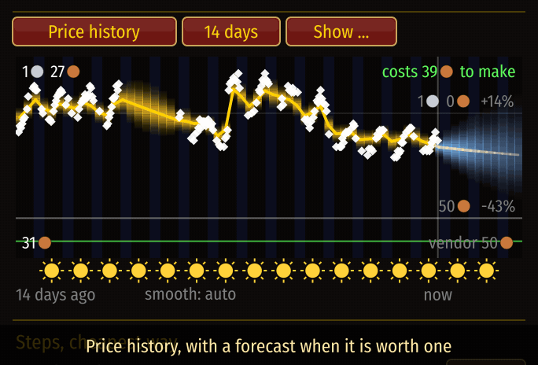
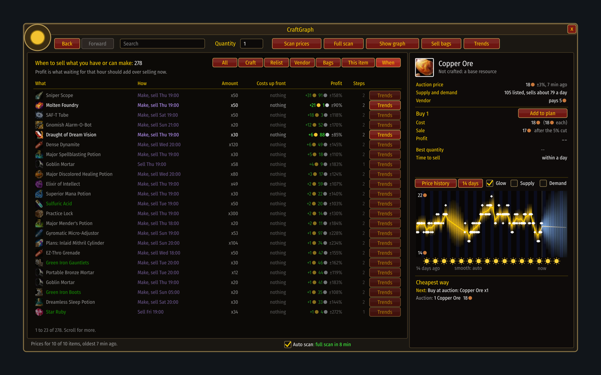

# When to sell

[Guide](../README.md) › Playing with it

Prices have habits: dearer in the evening when people play, cheaper at night, different at the
weekend. CraftGraph learns them from your scans.

## The price box
The box in the side panel has three pictures. Its heading button switches between them.

1. **Price history**: the price over time. The glow is how sure the estimate is; suns and moons
   under it show the time of day. Tick **Supply** to add how many were listed (blue) and
   **Demand** to add how many sold a day (green, with its scale in units a day at the right).
   Under the chart, click **smooth** to choose how long the lines are averaged over, from 15
   minutes to a day ("auto" lets the chart choose). Right-click goes back.

   
2. **Week pattern**: every recent scan placed on its hour of the week, moved to today's price
   level. Gold is the usual curve; blue is where the coming week is heading.
3. **Day pattern**: the same, folded onto one day.

## Reading a time
In the folded pictures, drag or scroll to pick a time. The lines under the chart give the usual
price then, the price expected the next time that hour comes round, and how much data is behind
it.

## The "When" list
In Opportunities, **When** lists what you hold or can make with its best selling hour this week
and what waiting should add. A later hour is only named when it beats now by more than the doubt
that waiting brings.

If you see no curves and "Too early to forecast", read [Forecasts](../understand/forecasts.md).

Next: [Trends](trends.md)
