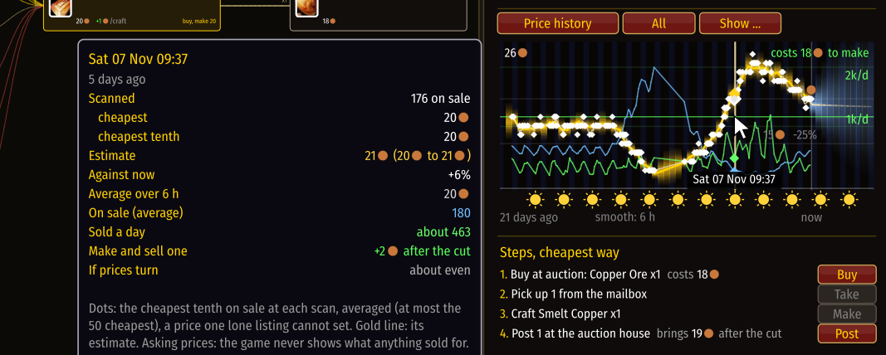
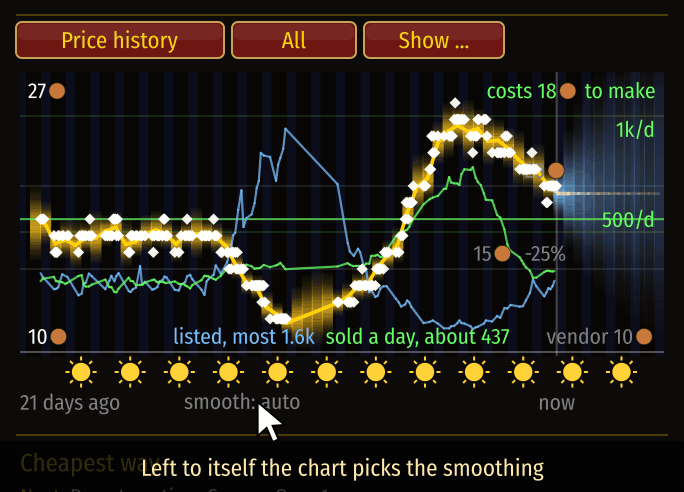
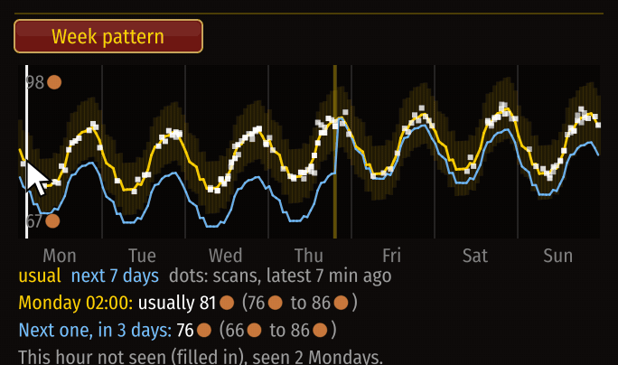

# When to sell

[Guide](../README.md) › Playing with it

Prices have habits: dearer in the evening when people play, cheaper at night, different at the
weekend. CraftGraph learns them from your scans.

## The price box
The box in the side panel has three pictures. Its heading button switches between them.

1. **Price history**: the price over time. Each white dot is one scan: the average price of the
   cheapest tenth of what was on sale (at most the 50 cheapest), a price one lone cheap listing
   cannot set. The gold line is the estimate of it and the glow how sure that is; suns and moons
   under it show the time of day. The **Auction price** above the chart is something else: the
   single cheapest listing at the last scan. Both are asking prices: the game never shows what
   anything sold for, only (by what vanishes) how many sold. **Show ...** opens the tick boxes for
   what is drawn:
   - **Grid with prices** (on to start with): faint lines at round prices, each with its price
     and how far it is from the price now, so you can read off how big a move was.
   - **Change bars**: one small bar per day, green when the price rose from the day before, red
     when it fell, taller for more.
   - **Certainty glow**, **Supply** (units listed, blue) and **Demand** (sold a day, green, with
     its scale in units a day at the right).
   - **Margin (profit each)**: a pink line for what making one and selling it would have left
     at each scan, after the auction house's cut, with the materials at their prices of that
     moment. The faint pink line is nothing: above it pays, below it loses. Its caption says the
     margin now and where it is heading ("rising 42c a day, 93% sure"), with a fainter line
     for the next day. It only names a direction when it is fairly sure of one.
   - **Readout under the mouse** (on to start with): hover the chart and a line marks that
     moment, with its time at the foot and a mark where it crosses each line. Beside the chart
     are the numbers of that moment: the scan there (when one is within a few pixels), where it
     came from (your scan, the base data, Blizzard's data, a shared price, Auctionator), how many
     were on sale, its cheapest price and its cheapest tenth (the dot); the estimate (or
     forecast) with its range and how it compares with now,
     the average, supply, demand and margin when those lines are drawn, and what making and
     selling one at that price would have left after the cut, with what you could lose if prices
     turn.

     
   Under the chart, click **smooth** to choose how long the lines are averaged over, from 15
   minutes to a day ("auto" lets the chart choose). Right-click goes back.

   
2. **Week pattern**: every recent scan placed on its hour of the week, moved to today's price
   level. Gold is the usual curve; blue is where the coming week is heading.
3. **Day pattern**: the same, folded onto one day.

## Reading a time
In the folded pictures, drag or scroll to pick a time. The lines under the chart give the usual
price then, the price expected the next time that hour comes round, and how much data is behind
it.

## The "When" list
In Opportunities, **When** lists what you hold or can make with its best selling hour this week
and what waiting should add. A later hour is only named when it beats now by more than the doubt
that waiting brings.

If you see no curves and "Too early to forecast", read [Forecasts](../understand/forecasts.md).

Next: [Trends](trends.md)
