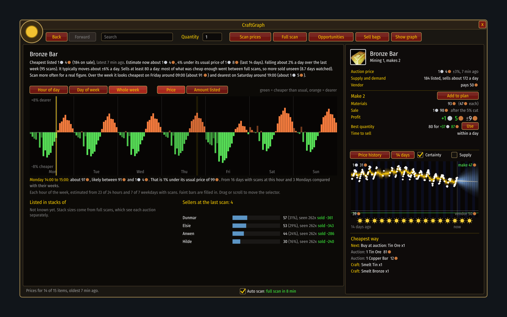

# Trends

[Guide](../README.md) › Playing with it

One item in depth. Press **Trends**, or type `/cg trends`.

- **The facts on top** start with what the last scan saw (cheapest price, how many on sale, how
  old the scan is). Then come the estimate, the direction over the last week, and how fast it
  sells.
- **The bars** show the price, or the amount listed, by hour of day, day of week, or the whole
  week. Green is cheaper than usual, orange dearer. Faint bars rest on little data.
- **The selector**: click, drag or scroll on the bars; the line under the chart reads that time.
- **Listed in stacks of**: which stack sizes people post, so you can match them.
- **Sellers**: who is listing, how much of the supply is theirs, and how much of theirs has sold.

Next: [Auto scan](auto-scan.md)
