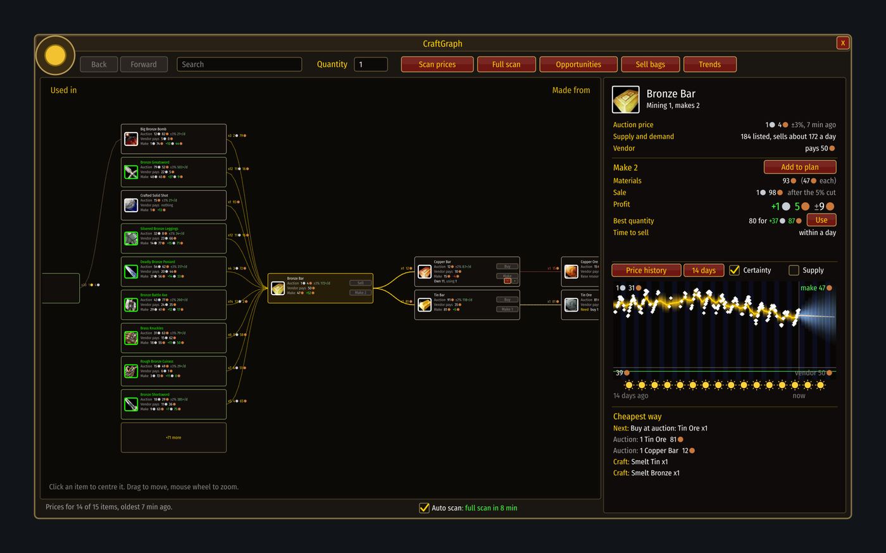

# Your first session

[Guide](../README.md) › Getting started

1. **Open the auction house** and type `/cg`.
2. **Press Full scan.** It reads every auction in about ten seconds. The game allows one every 15
   minutes; with Auto scan ticked the addon does the next ones by itself while the window is open.
3. **Open each of your profession windows once**, so the addon can read which recipes you know.
4. **Press Opportunities.** That is the list of ways to make money right now.
5. **Click any row** to see it on the graph, or press **Plan it** to have the small plan window
   walk you through it.

## What to expect on day one
After one scan the addon knows today's prices and nothing about tomorrow. So it shows what it saw
and holds back forecasts: you will read "Too early to forecast" in several places. That is on
purpose. Forecasts appear by themselves after about two days of scans. See
[Forecasts](../understand/forecasts.md).

Next: [Opportunities](../play/opportunities.md)
