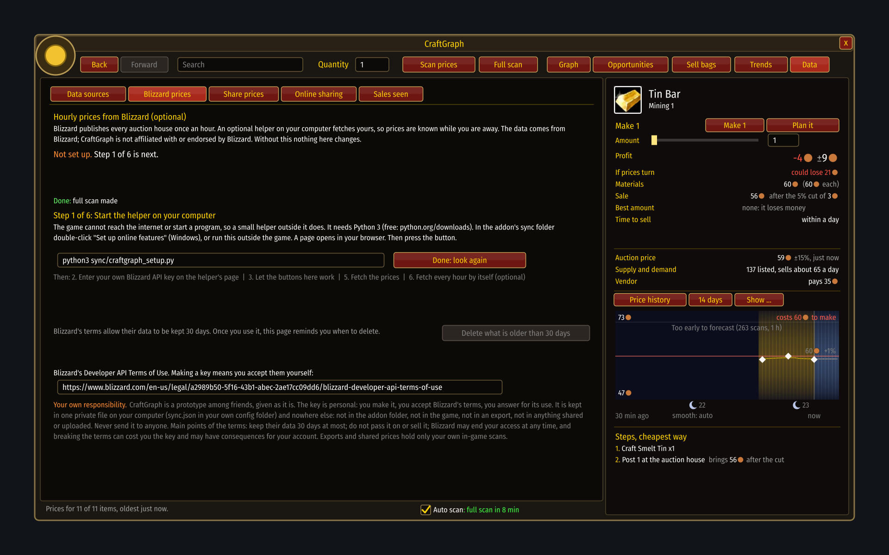
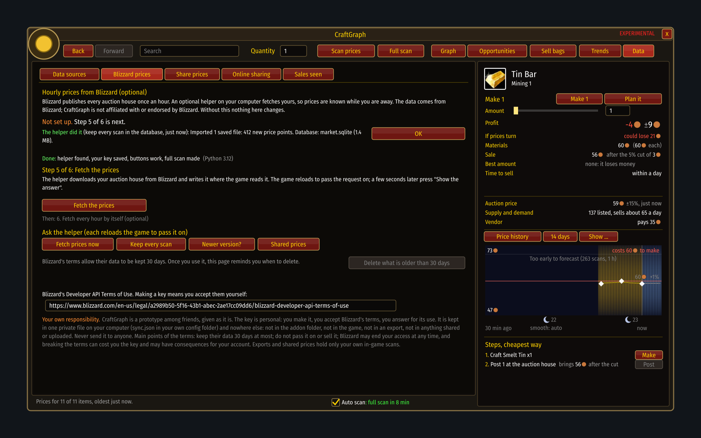

# Data sources

[Guide](../README.md) › Understanding it

Your own scans always count. Everything else is a second opinion that may be wrong, stale, or
about another auction house, so each has a switch.


They live on the **Data** page (the last of the page buttons along the top), which has four
sub-pages: **Data sources**, **Share prices**, **Online sharing** and **Sales seen**. Clicking the
status line under the graph, the button beside the auction window, or `/cg sources` also opens it.
A source that is not there (not set up, not installed) has no tick and says why.

| Source | What it adds | Needs |
|---|---|---|
| Your own scans | everything | nothing |
| Sales seen between full scans | how fast things sell | two full scans within 12 hours |
| Auctionator's prices | prices for items you have not scanned here | the Auctionator addon |
| Blizzard's hourly data | prices and sales while you are away | Python 3 and a free Battle.net API key |
| Base data shipped with the addon | history from before your first scan | being on its auction house |

Switch one off and the numbers are worked out again without it, so you can see what it changes.

## The base data
The addon comes with prices its author scanned on one auction house (CAMWOW EU4 Realm 2 PvP,
Alliance; the Data sources page says which, and from when to when). On that auction house a new
install starts with history instead of nothing: prices and how many were on sale, the last price
ladder, how listings were stacked, how fast things sold, vendor prices and where the vendors
stand, and the market's habits that the estimates start from. The [News](../play/news.md) can then
compare from the first day.

It is history, not the here and now:
- For each item it is used only for the time **before your own first scan** of that item. Once you
  have scanned something, your scans lead and the base data only fills in the time before.
- A price that only the base data has seen shows its age and says "base data", and like any old
  price it counts as stale.
- How fast things sold fades with age the way your own evidence does: half its weight a week.
- On any other auction house it is not used at all.

It holds no seller or character names, and none of Blizzard's web data: Blizzard's terms forbid
passing that on, even averaged or summed up. Scans that were only part of the auction house (a
fault fixed after 0.3.0, see [How history is stored](../internals/storage.md)) are left out of it.

## Sharing prices with another player
The **Share prices** sub-page (or `/cg share`) has a box of text.

- **Export my prices** fills it with the prices of your scans from the last day. Copy it and send
  it, or save it as a file ending in `.cg.json`.
- **Import** takes in whatever is pasted in the box. Under the box it says what happened: how
  many prices came in and from whom, or why nothing did.

A `.cg.json` file can also be brought in from outside the game, since the game cannot open files:
on Windows double-click **Import CraftGraph data** and pick the file; with Python,
`sync/craftgraph_sync.py share-import <file>` (and `share-export` writes one). At your next login
the game says in chat how many prices it took in.

Shared prices are a second opinion: used only where they are newer than your own scan, never
mixed into your own history, refused if they are for another auction house unless you insist,
and switched off with one tick.

The format is plain JSON, so anything can read or make it:

```json
{ "format": "craftgraph-prices", "version": 1,
  "realm": "<auction house>", "from": "<character>", "made": 1794317899,
  "items": { "2840": { "t": 1794317022, "n": 148, "l": [970, 14, 974, 61] } } }
```

`l` is the price ladder: price, units, price, units. Fields a version does not know are ignored,
so the format can grow.

## A shared repository on GitHub (optional)
The **Online sharing** sub-page (or `/cg github`) shows whether you are connected, who shares
with you, and the commands to run outside the game, ready to copy.

Players who want to can pool their prices in one public repository, each in a file of their own,
tagged with their character's name and GitHub account. The addon then lists each player as a
source of their own, by character name, with a switch.

- **Reading** needs no account: `sync/craftgraph_sync.py data-pull` fetches what others shared for
  your auction house; the game takes it in at your next login.
- **Sharing** needs a GitHub account that the repository's owner has let in, and the GitHub CLI
  logged in on your computer: `data-sync` shares yours and fetches the others'.
- **What becomes public** when you share: your character's name, your GitHub name, and the prices
  from your scans of the last day.

Your own shared prices are never imported back; you are listed first among the players, to show
that you are there.

Everything else stays on your computer. Without this the addon is unchanged.

## Hourly prices from Blizzard, and what you take on
The **Blizzard prices** sub-page (or `/cg blizzard`) sets it up step by step. It shows only what
is left to do: the next step in full, the later ones by name, and what is done on one line.



The game cannot run a program or reach the internet, so the key is entered outside it, on the
**setup page**. With Python 3 installed, double-click **Set up online features** in the addon's
`sync` folder (Windows) or run `sh sync/setup.sh` (Linux, Mac). A page opens in your browser,
served by your own computer and reachable only from it. It walks through the steps in order:
what you take on, your key, fetching the prices (once or every hour), the thirty days, and the
extras that need no key (keep every scan, look for a newer version, shared prices). Each button
runs the same command you could type yourself and shows what it printed. Without Python the
launcher says so and nothing else changes.

### Buttons in the game
The game cannot start a program. So a button in the game (**Fetch the prices**, **Keep every
scan**, **Newer version?**, **Shared prices**, **Delete what is older than 30 days**) leaves a
request in the addon's saved data and reloads the game, which saves it. A helper outside the game
sees the file change, does what was asked, and writes its answer where the game reads it. The
game only reads files when it loads, so **Show the answer** reloads once more.



The helper listens while the setup page is open, or always once you press **Let the game's
buttons work, always** on that page (Linux; on Windows keep the page open, or run
`python craftgraph_sync.py watch`). Only a fixed list of actions can be asked for, the request
holds nothing but the action's name, and the key never comes into the game: the game is told
only that one is saved. If nobody answers, the page says so instead of waiting.

- **The key is yours.** You make it at Blizzard under your own account, which means you accept
  [Blizzard's Developer API Terms of Use](https://www.blizzard.com/en-us/legal/a2989b50-5f16-43b1-abec-2ae17cc09dd6/blizzard-developer-api-terms-of-use) yourself. It is kept in one private file on your
  computer and never in the addon folder, an export or anything uploaded.
- **Thirty days.** Blizzard's terms allow their data to be kept 30 days at most. The page shows
  how old the oldest data in use is, turns orange when it is overdue, and has a button, **Delete
  what is older than 30 days**. The button stops the game using it at once; the files on your
  computer are deleted by the tool's `purge` command, shown on the same page. Doing it is up to
  you: nothing is deleted behind your back.
- **It is never passed on.** Exports and shared prices hold only your own in-game scans.

How you use this is your own responsibility; see [LEGAL.md](../../LEGAL.md).

## The optional Python tool
The game cannot reach the internet or write a database, so those two jobs sit in a small tool,
`sync/craftgraph_sync.py`, that runs outside the game:

- `craftgraph_setup.py` is the setup page described above: the same commands with buttons.
- `setup` and `run` bring Blizzard's hourly auction data in. This part has only been tested
  against a copy of the service, never the live one.
- `archive` copies every scan into a SQLite database and keeps the raw saved files.

Without Python nothing is missing in the game.

Next: [Under the hood](../internals/README.md)
