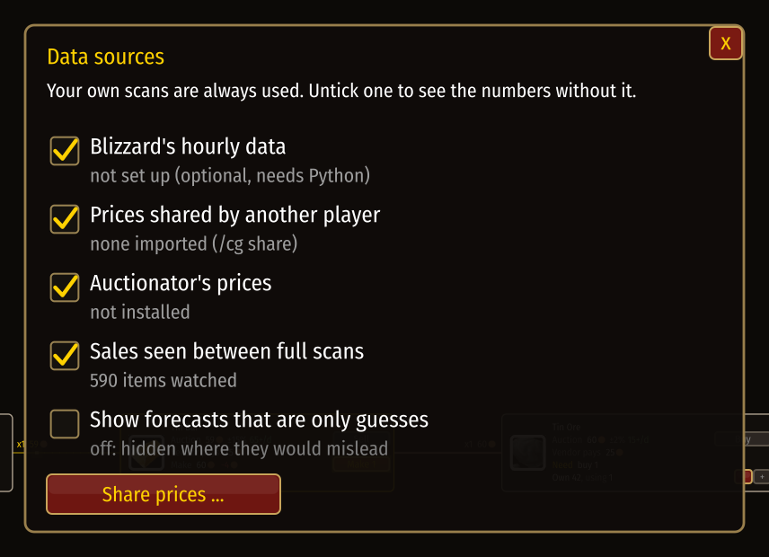

# Data sources

[Guide](../README.md) › Understanding it

Your own scans always count. Everything else is a second opinion that may be wrong, stale, or
about another auction house, so each has a switch.



Open it by clicking the status line under the graph, with the button beside the auction window,
or with `/cg sources`.

| Source | What it adds | Needs |
|---|---|---|
| Your own scans | everything | nothing |
| Sales seen between full scans | how fast things sell | two full scans within 12 hours |
| Auctionator's prices | prices for items you have not scanned here | the Auctionator addon |
| Blizzard's hourly data | prices and sales while you are away | Python 3 and a free Battle.net API key |

Switch one off and the numbers are worked out again without it, so you can see what it changes.

## Sharing prices with another player
`/cg share` opens a box of text.

- **Export my prices** fills it with the prices of your scans from the last day. Copy it and send
  it, or save it as a file ending in `.cg.json`.
- **Import** takes in whatever is pasted in the box. Under the box it says what happened: how
  many prices came in and from whom, or why nothing did.

A `.cg.json` file can also be brought in from outside the game, since the game cannot open files:
on Windows double-click **Import CraftGraph data** and pick the file; with Python,
`sync/craftgraph_sync.py share-import <file>` (and `share-export` writes one). At your next login
the game says in chat how many prices it took in.

Shared prices are a second opinion: used only where they are newer than your own scan, never
mixed into your own history, refused if they are for another auction house unless you insist,
and switched off with one tick.

The format is plain JSON, so anything can read or make it:

```json
{ "format": "craftgraph-prices", "version": 1,
  "realm": "<auction house>", "from": "<character>", "made": 1794317899,
  "items": { "2840": { "t": 1794317022, "n": 148, "l": [970, 14, 974, 61] } } }
```

`l` is the price ladder: price, units, price, units. Fields a version does not know are ignored,
so the format can grow.

## A shared repository on GitHub (optional)
Players who want to can pool their prices in one public repository, each in a file of their own,
tagged with their character's name and GitHub account. The addon then lists each player as a
source of their own, by character name, with a switch.

- **Reading** needs no account: `sync/craftgraph_sync.py data-pull` fetches what others shared for
  your auction house; the game takes it in at your next login.
- **Sharing** needs a GitHub account that the repository's owner has let in, and the GitHub CLI
  logged in on your computer: `data-sync` shares yours and fetches the others'.
- **What becomes public** when you share: your character's name, your GitHub name, and the prices
  from your scans of the last day.

Everything else stays on your computer. Without this the addon is unchanged.

## The optional Python tool
The game cannot reach the internet or write a database, so those two jobs sit in a small tool,
`sync/craftgraph_sync.py`, that runs outside the game:

- `setup` and `run` bring Blizzard's hourly auction data in. This part has only been tested
  against a copy of the service, never the live one.
- `archive` copies every scan into a SQLite database and keeps the raw saved files.

Without Python nothing is missing in the game.

Next: [Under the hood](../internals/README.md)
