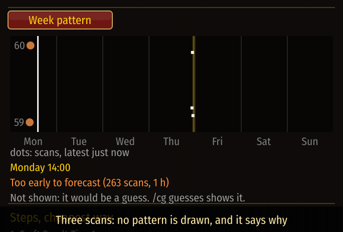

# Forecasts, and when there are none

[Guide](../README.md) › Understanding it

## What is forecast
A price is taken to be three things added together:
1. a **level** that wanders, with a **trend** that fades unless new scans confirm it;
2. **habits**: the effect of the hour of the day and the day of the week;
3. scatter in what one scan happens to see.

From those come the forecast line on the chart, the week and day patterns, the best hour to sell,
and a plan's profit by when it sells. Every forecast has a range it should land in about two
times in three.

## When it is not shown
A forecast from a handful of scans, or for a price that jumps about, looks like knowledge and is
not. So each item is judged first:

| Verdict | Means | What you see |
|---|---|---|
| Too early | under 8 scans, or under 2 days of them | only what was scanned |
| Too unsettled | by tomorrow it could be a third either way | only what was scanned |
| Fine | enough to go on | forecast; patterns too once the same hours were scanned on 3 days |

Where something is held back, the place says why.

## Seeing the guesses anyway
Tick **Show forecasts that are only guesses** in the data sources window, or type `/cg guesses`.

## How good is it?
Honestly: on the first day of real data the best guess for the next scan was simply the last
scan, and the model was tuned to respect that. The trend and the habits could not be checked on
real data yet; they help on simulated markets that have such patterns. The thresholds above are
judgment, not measurement. More in [The price model](../internals/price-model.md).

Next: [How fast things sell](sales.md)
