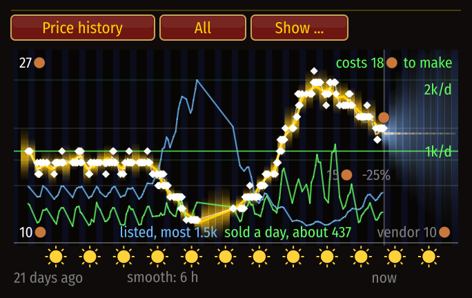

# How fast things sell

[Guide](../README.md) › Understanding it

The game never says what sold. CraftGraph works it out.

## The idea
A full scan lists every auction with its seller, its stack, its price and roughly how long it has
left. Compare two full scans and some auctions are **gone**. Each of those was sold, cancelled,
or ran out of time. So each gets a **chance of having sold**:

- less if its time was nearly up;
- less if the same seller put up new ones in the meantime (a relist);
- less if cheaper ones were left standing, since buyers take the cheapest first.

Adding those up gives units sold between the two scans, and over many scans a selling rate per
day with a range. Old evidence fades, because demand on a young server does not hold still.

## Where you see it
- on graph cards as `120/d`;
- in the side panel ("sells about 120 a day") and in Trends, with the sellers whose auctions sold;
- as the green line on the price chart when **Demand** is ticked, evened out over a stretch of
  time, with its scale in units a day;
- in batch sizes: the addon will not suggest making more than the market takes.

In this simulated example the blue line (units listed) triples while the price sinks: goods
piling up. Later the green line (units sold a day) doubles, the blue line drains and the price
jumps: real demand. Reading the three together tells you which kind of move you are looking at.

## The list of sales
The **Sales seen** sub-page of Data (or `/cg sales`) lists every auction judged sold, newest
first: when it was found gone, the item, the stack, the price, the seller and how sure. Clicking
"Supply and demand" in the side panel opens the same list for just that item.

## Its limits
It needs two full scans within twelve hours. Auctions posted *and* sold between two scans are
never seen, so for a busy item scanned hours apart the figure is too low; then it reads "at
least". Measured against a simulated item: [The sales estimate](../internals/sales-model.md).

Next: [Data sources](data-sources.md)
